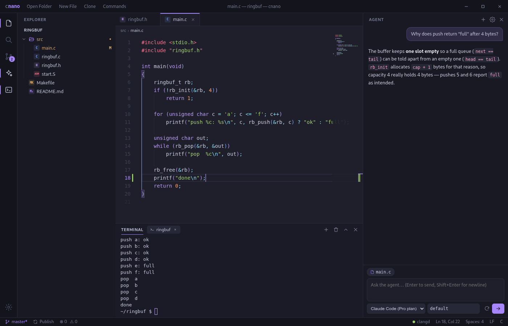
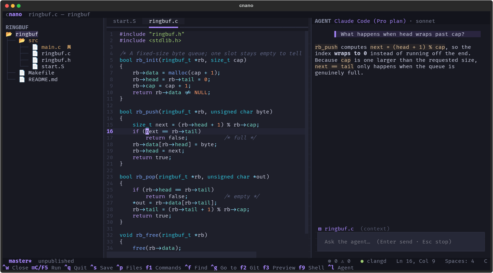

<p align="center">
  
</p>

<h1 align="center">cnano</h1>

<p align="center">
  <b>cnano is a text editor for low level developers, and is a calm place to write code.</b>
</p>

<p align="center">
  C · C++ · Assembly · shell — with Rust and Python along for the ride.<br>
  A desktop editor and a terminal editor that share one palette, one set of habits and one AI agent.
</p>

---





## Why cnano

Most editors are built for web stacks first. cnano starts from the other end: `gcc`, `nasm`, `as`/`ld`, Makefiles, linker scripts, shell — and keeps everything else out of the way. It looks like VS Code and Obsidian had a quiet child, and it keeps nano's muscle memory (`Ctrl+K` cuts a line, `Alt+Backspace` deletes a word).

It comes in two editions:

- **cnano** — the desktop editor (Electron + Monaco, the engine inside VS Code).
- **cnano-tui** — the same editor in your terminal (Python + Textual), for SSH sessions and tiling-WM life. Start it with `cnano-tui` or `cnano --tui`.

## Features

| | cnano (GUI) | cnano-tui |
|---|:---:|:---:|
| Syntax highlighting for C, C++, Rust, Python, shell, Markdown | ✓ | ✓ |
| Assembly (GAS/AT&T, NASM, ARM, RISC-V), Makefile, linker-script highlighting | ✓ | ✓ |
| **Compile & run** with `Super+C` — picks gcc / g++ / nasm / as / rustc / python | ✓ | ✓ |
| **Language servers** — diagnostics, completion, hover, go to definition, references, rename, quick fixes, format | ✓ | ✓ |
| **Git** — status colours, gutter markers, stage / commit / push / pull / clone / branches / stash, diffs, history | ✓ | ✓ |
| **AI agent** — Claude Code (your Pro plan), Anthropic, OpenAI, Gemini, OpenRouter, NVIDIA Build | ✓ | ✓ |
| Markdown preview with Obsidian `[[wikilinks]]`, `==highlights==` and `> [!note]` callouts | ✓ | preview |
| Built-in terminal with tabs | ✓ | `F9` drops to your shell |
| nano keys: `Ctrl+K` cut line (repeat to cut a block), `Alt+Backspace` delete word | ✓ | ✓ |
| Fuzzy file finder, command palette, project-wide search, find & replace | ✓ | ✓ |

### Compile & run

Press **`Super+C`** (or `F5`) on any source file. It's saved, built and run:

| File | What runs |
|---|---|
| `.c` | `gcc -Wall -Wextra -g … -lm` → run |
| `.cpp` `.cc` `.cxx` | `g++ -Wall -Wextra -std=c++20 -g` → run |
| `.asm` `.nasm` | `nasm -f elf64 -g` → `ld` → run |
| `.s` | GNU `as -g` → `ld` → run |
| `.S` | `gcc -c -g` (C preprocessor, so `#define` works) → `ld` → run |
| `.rs` | `rustc -g` → run |
| `.py` | `python3` |
| shell scripts, `Makefile` | `bash`, `make` |

The binary lands next to the source. Assembly is linked with plain `ld`, so programs start at `_start` with no libc.

### AI agent

`Ctrl+L` opens the agent beside your code. It can list, read and search files, edit them and run commands like `make`. Every edit and command shows a diff or the command line first and waits for you to apply or reject it, unless you choose to auto-approve.

- **Claude Code (Pro plan)** runs `claude -p` with your logged-in subscription, so no API key is needed. Chats resume across messages.
- **API providers:** Anthropic, OpenAI, Google Gemini, OpenRouter, NVIDIA Build. The model list is fetched live, or you can type any model id.
- The active file and selection are attached as context.
- Keys: the GUI encrypts them with your system keyring; the TUI keeps them in `~/.config/cnano/tui-keys.json` (mode `0600`). Both read `ANTHROPIC_API_KEY`, `OPENAI_API_KEY`, `GEMINI_API_KEY`, `OPENROUTER_API_KEY` and `NVIDIA_API_KEY` from the environment.

### Language servers

| Language | Server | How to get it |
|---|---|---|
| C / C++ | clangd | your distro (`clangd` / `clang-tools`) |
| Python | pyright (also basedpyright, pylsp, jedi-language-server) | `make lsp` |
| Rust | rust-analyzer | `make lsp` |
| Assembly | asm-lsp — instruction & register docs, completion, assembler diagnostics | `make lsp` (builds with cargo) |

`make lsp` installs into `~/.local/share/cnano/lsp` and changes nothing globally. Both editors look on your `PATH` first, then there.

For real C/C++ projects, give clangd your build flags with a `compile_commands.json`: run `bear -- make`, or configure CMake with `-DCMAKE_EXPORT_COMPILE_COMMANDS=ON`. Without one it falls back to `-Wall -Wextra`. rust-analyzer needs a `Cargo.toml` in the project.

## Install

### Requirements

| Needed for | Packages |
|---|---|
| building & running | `git`, `node` ≥ 18 + `npm`, `python3` ≥ 3.10 (with `venv`), `make`, `g++`, `bash` |
| compile & run (optional, per language) | `gcc`, `g++`, `nasm`, `binutils` (`as`, `ld`), `rustc` |
| language servers (optional) | `clangd`, plus `npm` / `curl` / `cargo` for `make lsp` |
| Claude Code provider (optional) | [`claude`](https://claude.com/claude-code), logged in |

### Build and install

```sh
git clone https://github.com/ENux-Distro/cnano.git
cd cnano
make                          # npm install, native rebuild, stage the GUI and the TUI
make test                     # check this machine has everything (see below)
sudo make install             # → /usr/local: cnano, cnano-tui, desktop entry, icon
```

Prefer no sudo? `make install PREFIX=~/.local`. To remove it, run `sudo make uninstall` with the same `PREFIX`. Settings stay in `~/.config/cnano`.

### Run

```sh
cnano                 # GUI, reopens your last folder
cnano ~/src/kernel    # open a folder
cnano main.c          # open a file
cnano --tui main.c    # the terminal edition (same as cnano-tui)
```

From a checkout without installing: `npm start` (GUI) or `make run-tui`.

## Keys

| Action | cnano (GUI) | cnano-tui |
|---|---|---|
| Command palette | `Ctrl+Shift+P` / `F1` | `F1` |
| Go to file | `Ctrl+P` | `Ctrl+P` |
| Save / save all | `Ctrl+S` / `Ctrl+Alt+S` | `Ctrl+S` |
| Close tab / quit | `Ctrl+W` / window ✕ | `Ctrl+W` / `Ctrl+Q` |
| Cut line (nano) | `Ctrl+K` | `Ctrl+K` |
| Delete word left | `Alt+Backspace` | `Alt+Backspace` |
| Find / replace | `Ctrl+F` / `Ctrl+H` | `Ctrl+F` / `Ctrl+R` |
| Go to line | `Ctrl+G` | `Ctrl+G` |
| Compile & run | `Super+C` / `F5` | `Super+C`¹ / `F5` |
| Terminal | ``Ctrl+` `` | `F9` (shell) |
| AI agent | `Ctrl+L` | `Ctrl+L` |
| Source control | `Ctrl+Shift+G` | `F2` |
| Markdown preview | `Ctrl+Shift+V` / `Ctrl+E` | `F3` |
| Toggle sidebar | `Ctrl+B` | `Ctrl+B` |
| Completion | as you type / `Ctrl+Space` | `Ctrl+Space`, or after `.` `->` `::` |
| Go to definition / references | `F12` / `Shift+F12` | `F12` / `Shift+F12` |
| Hover info | mouse hover | `F6` |
| Symbols in file | `Ctrl+Shift+O` | `F7` |
| Next problem | `F8` | `F8` |
| Quick fix | `Ctrl+.` | `Alt+Enter` |
| Rename symbol | `F2` | `F1 › LSP: Rename` |

¹ In the terminal, Super+C needs a terminal that speaks the kitty keyboard protocol: kitty, foot, WezTerm, Ghostty or Alacritty. Elsewhere use `F5`.

In the TUI's git panel: `s` stage/unstage, `a` stage all, `x` discard, `c` commit, `p` push, `l` pull, Enter shows the diff. When the agent asks before acting: `y` apply, `n` reject, `a` always allow.

## Tests

```sh
make test         # everything, including one tiny live `claude -p` call
make test-quick   # same, without the Claude call
```

The suite (Python's built-in `unittest`, no extra packages) checks two things:

- **This machine:** the required tools and versions, that the npm packages are installed, that the terminal's native module loads inside Electron, that the TUI's dependencies import, that every compiler on the run table builds and runs a hello-world, that each language server completes a real handshake, and that Claude Code is installed, new enough and actually answers a prompt. Missing *optional* pieces show up as skipped, with the reason and how to install them.
- **cnano's own logic:** language detection, run commands (the GUI and the TUI must agree), git-gutter diffs, UTF-16 positions for LSP, and the agent's provider adapters against canned streams in each provider's format (edits, commands, approvals, cancellation, key storage).

## Project layout

```
main.js  preload.js        Electron main process & the bridge to the page
agent.js  lsp.js           AI agent backend, language-server manager (GUI)
renderer/                  the GUI: editor, tree, git, terminal, gutter, agent panel, LSP glue
tui/cnano_tui/             cnano-tui: app, git, agent + panel, LSP client, languages, theme
scripts/install-lsp.sh     language servers → ~/.local/share/cnano/lsp
tests/                     environment checks and unit tests
Makefile                   build, test, install
```

## Troubleshooting

- **Terminal panel is blank or errors** — node-pty was built for a different Electron. Run `npx electron-rebuild -f -w node-pty` (or `make`).
- **Push or pull fails without asking for a password** — on purpose: cnano never shows a password prompt it can't handle. Use an SSH remote (`git@github.com:…`) or set up a git credential helper.
- **clangd reports errors in code that compiles** — it doesn't know your flags yet; generate `compile_commands.json` (see *Language servers*).
- **Super+C does nothing** — your desktop or window manager may be using the shortcut. `F5` does the same thing.
